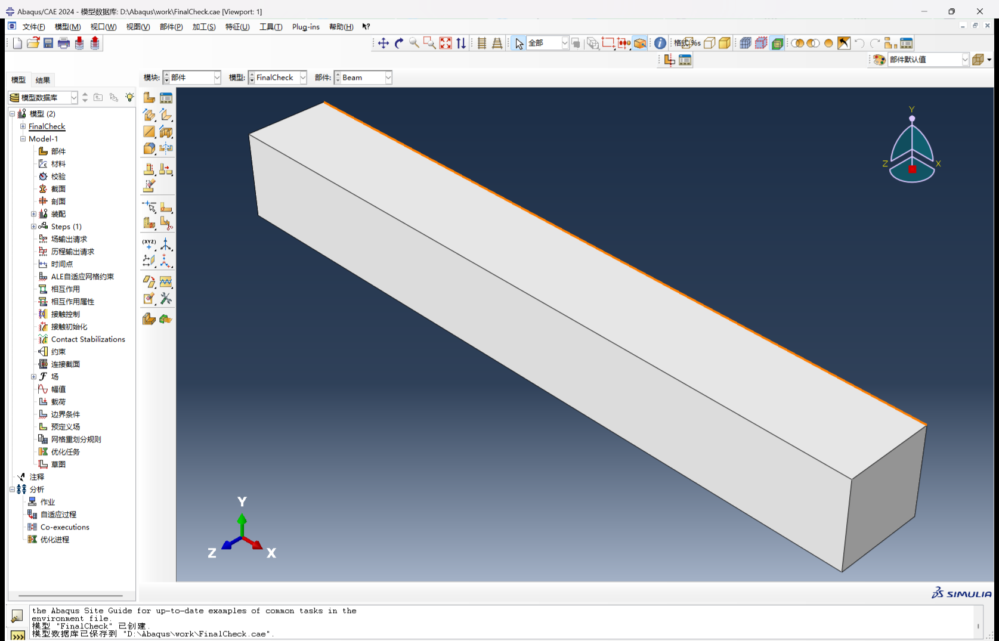

# dsh-abaqus-cad

把 **Abaqus/CAE 2024+** 接到 [DeepSeek Harness](https://github.com/deepseek-ai)（dsh）/
Codex：首次加载 / `doctor` 先检测本机 Abaqus 及其版本，再用 **24 个 MCP 工具**完成
“建模 → 网格 → 分析 → 求解 → 后处理”，既可以跑独立后台内核，也可以直接驱动
你已经打开的 CAE GUI。




## 特性

- **先检测，再安装/加载**：读取 `abaqus information=versions` 与
  `%SIMULIA%\EstProducts\<年份>`，报告版本、CAE 内置 Python、求解器是否存在；
  **2024 以下默认拒绝加载**。
- **双会话模式**：独立后台内核（快）或 attach 已打开的手动 GUI（实时可见）；
  也可由插件启动一个可见 CAE 并在结束时关闭。
- **24 个工具按需检索**：会话只广告 `search_tools` / `call_tool`，空闲约 270 token。
- **几何/网格/耦合**：`revolve`、`cone`、`tube`、`coupling`（RP 总力）、
  `technique/shape` 网格控制、`abaqus_inspect` 明细、ODB 极值/探针/云图。
- **强制收尾**：`abaqus_finish` 保存 `.cae`、关闭 ODB、结束会话；只关插件自己
  启动的 CAE，不误关你手开的窗口。

## 环境要求

| 项 | 要求 |
|---|---|
| 操作系统 | Windows 10/11 |
| Abaqus | **2024、2025 或更新**（CAE + Analysis；仅 CAE 可建模/后处理，不能求解） |
| Abaqus 内置 Python | 3.10（2024/2025 自带） |
| 主机 Python | 3.8+（MCP 服务器只用标准库） |
| dsh | 支持 `plugin_manager` / `dsh-mcp-client` 的版本 |
| Node | 20+（dsh 自带运行时即可） |

### 版本检测

插件加载时和 `doctor` 都会执行：

```
abaqus information=versions
%SIMULIA%\EstProducts\<year>\win_b64\code\bin\pre.exe / standard.exe
%SIMULIA%\EstProducts\<year>\win_b64\tools\SMApy\python3.10\python.exe -V
```

- **Abaqus ≥ 2024**：正常加载。
- **Abaqus ≤ 2023**：默认报错并拒绝加载（老版本 Python/API 不保证兼容）。
  仅实验可用 `ABAQUS_ALLOW_UNSUPPORTED=1` 强行放行。
- 可用 `ABAQUS_MIN_VERSION=2025` 提高下限，`ABAQUS_CMD` 指定 `abaqus.bat`。

先自检：

```powershell
# 已发布到 npm 后
npx dsh-abaqus-cad doctor
# 未发布时可直接从 GitHub 运行
npx -y github:Polymerizedcat/dsh-abaqus-cad doctor

# 或从仓库/本地目录
node bin/dsh-abaqus-cad.mjs doctor
```

输出示例（Abaqus 2024）：

```text
dsh-abaqus-cad 0.4.0
Abaqus found : yes
Version      : 2024 (requires 2024+)
Supported    : yes
Command      : C:\SIMULIA\Commands\abaqus.bat
Install root : C:\SIMULIA\EstProducts\2024\win_b64
Python       : 3.10.5 (...\tools\SMApy\python3.10\python.exe)
Solver       : present
Installations: 2024
```

## 安装

### 方式 A：GitHub 仓库（推荐）

```text
plugin_manager install_bundle target=github:Polymerizedcat/dsh-abaqus-cad
```

仓库根目录即本包（`package.json` 在根）。如果当前 dsh 的
`plugin_manager` 不接受 `github:` spec，先 `git clone` 再按方式 C 指向本地目录。

### 方式 B：npm 包名

包发布到 npm 后（若 `dsh-abaqus-cad` 名称被占用，改用 GitHub 方式）：

```text
plugin_manager install_bundle target=dsh-abaqus-cad
```

### 方式 C：本地目录 / tarball

```text
plugin_manager install_bundle target=D:\path\to\dsh-abaqus-cad
# 或 npm pack 后
plugin_manager install_bundle target=D:\path\to\dsh-abaqus-cad-0.4.0.tgz
```

安装后：

1. 重启 dsh（加载插件、写入 `~/.dsh/abaqus-cad.json`、安装 `abaqus-fea` 技能）；
2. **重启一次 Abaqus/CAE**，让
   `%USERPROFILE%\abaqus_plugins\dsh_abaqus_bridge_plugin.py` 自动加载；
3. 如 GUI 桥未启动：`abaqus_session {"action":"install_gui"}` 后重开 CAE。

## 快速开始

任何任务开始前先让用户选模式（Skill 已内置）：

```text
abaqus_status
abaqus_session {"action":"start","mode":"background"}        # 后台内核
abaqus_session {"action":"start","mode":"gui"}               # 驱动已打开的 CAE
abaqus_session {"action":"start","mode":"gui","launch":true} # 插件开可见窗口
```

典型流程：

```text
abaqus_part    {"kind":"revolve","name":"Rod","model":"Rod",
                "profile":[[0,0],[15,0],[15,300],[10,300],[10,800],
                           [8,800],[8,1100],[5,1100],[5,1400],[0,1400]]}
abaqus_material{"name":"Steel","E":210000,"nu":0.3,"density":7.85e-9,"model":"Rod"}
abaqus_section {"name":"Sec","material":"Steel","part":"Rod","model":"Rod"}
abaqus_instance{"part":"Rod","name":"Rod-1","model":"Rod"}
abaqus_mesh    {"part":"Rod","size":20,"elem":"C3D10",
                "technique":"free","shape":"tet","model":"Rod"}
abaqus_step    {"name":"Step-1","kind":"static","nlgeom":true,"model":"Rod"}
abaqus_bc      {"name":"Fixed","kind":"encastre","step":"Initial","model":"Rod",
                "region":{"at":[[0,0,0]],"instance":"Rod-1"}}
# revolve 的轴向是 sketch 的 Y 轴（本示例杆长沿 Y）
abaqus_coupling{"name":"Tip","point":[0,1400,0],"step":"Step-1","model":"Rod",
                "surface":{"at":[[0,1400,0]],"instance":"Rod-1"},
                "force":{"cf1":100,"cf3":-100}}
abaqus_job     {"action":"create","name":"Rod-NL","model":"Rod","cpus":4}
abaqus_job     {"action":"submit","name":"Rod-NL","cpus":4}
abaqus_job     {"action":"wait","name":"Rod-NL","timeout":600}
abaqus_odb     {"action":"extrema","path":"Rod-NL","field":"U","component":"Magnitude"}
abaqus_finish  {"save":"D:/Abaqus/work/rod.cae"}
```

> 收尾必须调用 `abaqus_finish`。它会保存模型、关闭 ODB、结束会话：
> 后台内核退出；插件启动的 GUI 关闭；你手开的 GUI 只断开桥接、不关窗口。

## 工具（24 个，按需检索）

| 阶段 | 工具 |
|---|---|
| 会话 | `abaqus_status` `abaqus_session` `abaqus_finish` `abaqus_open` `abaqus_save` |
| 模型 | `abaqus_model_new` `abaqus_model_info` `abaqus_inspect` `abaqus_run_python` |
| 几何/属性 | `abaqus_part`（box/cylinder/cone/tube/revolve/shell/polygon/import） `abaqus_material` `abaqus_section` `abaqus_instance` `abaqus_set` |
| 分析 | `abaqus_mesh`（technique/shape） `abaqus_step` `abaqus_bc` `abaqus_load` `abaqus_interaction` `abaqus_coupling` |
| 求解 | `abaqus_job`（create/write/submit/status/wait/abort） |
| 结果 | `abaqus_odb`（summary/extrema/probe/history） `abaqus_plot` `abaqus_export` |

服务器只广告 `search_tools` / `call_tool`；`search_tools` 支持中英文与 Abaqus 命令名。

## 架构

```
后台:  Agent → MCP(stdio) → server.py → socket 48901 → CAE 内核 (noGUI)
GUI :  Agent → MCP(stdio) → server.py → socket 48153 → CAE GUI 插件
                                                       → sendCommand → 内核
```

Abaqus/CAE 没有 COM 或远程内核接口。GUI 模式通过一个很小的 Abaqus AFX 插件
（`%USERPROFILE%\abaqus_plugins\dsh_abaqus_bridge_plugin.py`）在 GUI 进程内开
本地 socket，用 `sendCommand` 把代码送进内核；这是 attach 已打开 CAE 的稳定方式。

## 实测开销

| 项 | 值 |
|---|---|
| `tools/list` 常驻 | 960 字符 ≈ 270 token |
| 一次 `search_tools` | ≈ 60 token |
| GUI 模式单次调用 | 0.3–0.8 s |
| 后台模式单次调用 | 0.01–0.1 s |

## 验证状态

- [x] Abaqus 2024 实机：检测、后台求解、GUI attach、插件启动/关闭、24 工具
- [x] 版本门禁：`ABAQUS_MIN_VERSION=2099` 时 `doctor` 退出码 1 并拒绝加载
- [x] 变径杆 1 次 `revolve`（体积 453,017.7 mm³）
- [x] C3D10 free tet 网格；`abaqus_inspect` 单元类型统计
- [x] RP + Kinematic Coupling：100 N 端载 U3 = -0.214 mm（解析 0.192 mm）
- [x] 作业目录自动同步（CAE cwd ≠ workDir）
- [x] ODB `step=1`（1-based）/ `component=MAGNITUDE`
- [x] GUI 内核命名空间注入 `abaqusConstants` / `mesh` / `ElemType`
- [x] 532 MB 旧版 ODB（升级后）summary/extrema/probe/history
- [ ] Abaqus 2025 完整求解回归（CAE 部分兼容；同 Python 3.10）
- [ ] 显式/接触的标准算例回归

## 常见问题

| 现象 | 处理 |
|---|---|
| `doctor` 显示 not found | 安装 Abaqus 2024+；或设置 `ABAQUS_CMD=C:\SIMULIA\Commands\abaqus.bat` |
| `unsupported Abaqus 2023` | 2024 以下默认拒绝；实验可设 `ABAQUS_ALLOW_UNSUPPORTED=1` |
| `solver MISSING` | 只装了 CAE；补装 Abaqus Analysis（`pre.exe`/`standard.exe`） |
| GUI 模式 `No GUI bridge` | `install_gui` 后**重启 CAE**；或 `launch:true` 让插件开窗 |
| `input file ... not found` | 新版会自动从 CAE cwd 复制 `.inp` 到 workDir；仍失败则先 `job action=write` |
| `.cae/.jnl` 被占用 | attach 手动 GUI 时 `finish` 不关窗口；交付物先复制到独立目录 |
| 中文路径 | 插件自动建 NTFS ASCII 联接；按工具返回路径操作 |

## 仓库结构

```
lib/          dsh 插件入口、Abaqus 检测、路径解析
bin/          doctor / where CLI
mcp-server/   stdio MCP 服务器（catalog / handlers / bridge）
cae/          内核桥、GUI 桥、Abaqus helpers、渲染模板
skills/       abaqus-fea/SKILL.md + references
assets/       截图与图标
```

## 开发

```powershell
node bin/dsh-abaqus-cad.mjs doctor
python -m py_compile mcp-server/*.py cae/*.py
node --check lib/index.js
```

欢迎 issue / PR；提交前请确认不包含个人路径、`.cae/.odb`、日志和许可证文件。

## 许可与声明

MIT，见 [LICENSE](LICENSE)。GUI 桥部分改编自 MIT 许可的
[CAE-Agent-Hub](https://github.com/Cai-aa/CAE-Agent-Hub) 与
[Whfkl/Abaqus-Control-MCP](https://github.com/Whfkl/Abaqus-Control-MCP)，详见
[NOTICE.md](NOTICE.md)。

本项目与 Dassault Systèmes 无隶属关系；使用需自备合法 Abaqus 许可证。
